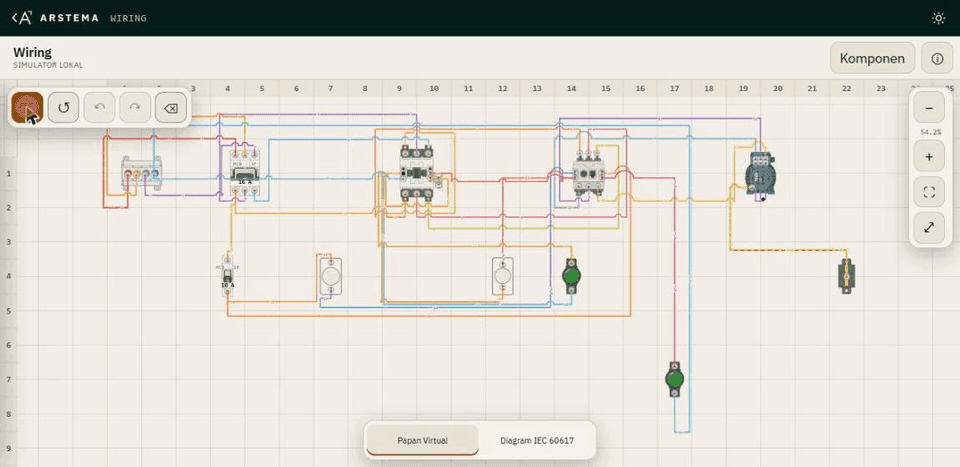

# @arstema/wiring

Satu sumber editor wiring TAKAR dan ARSTEMA. Engine, Visual, IEC, 3D dan routing
berjalan lokal di perangkat. Bukan sertifikasi desain listrik atau replika OEM.

**Live demo:** https://arstema.com/wiring



Versi video: [docs/demo.mp4](docs/demo.mp4)

## Build dan pemasangan lokal

Dari root repositori: `npm install`, `node build.mjs`, lalu
`npm pack --pack-destination tmp`. Instal berkas `.tgz` itu pada proyek
website. Contoh pemakaian ada di `examples/wiring-react` dan
`examples/wiring-javascript`.

React 18:

```tsx
import {WiringApp} from '@arstema/wiring';
import '@arstema/wiring/style.css';
// Container wajib punya tinggi eksplisit. Namespace stabil dan unik per proyek/instance.
export default function Editor(){return <div style={{height:'85vh'}}>
  <WiringApp namespace="arstema:project-a" onError={console.error}/>
</div>}
```

JavaScript tanpa framework (browser entry sudah membawa React):

```js
import {createWiringApp} from '@arstema/wiring/browser';
import '@arstema/wiring/browser.css';
const app=createWiringApp(document.querySelector('#wiring'),{namespace:'arstema:project-a'});
const project=app.getProject();
app.loadProject(project); // false untuk input tidak sah; proyek aktif tidak diganti
app.setActive(false); // jeda dan sembunyikan, state tetap ada
app.setActive(true);
app.destroy(); // flush storage dan bersihkan resource; aman dipanggil ulang
```

Untuk halaman HTML tanpa bundler, salin SELURUH `dist/browser` ke hosting,
gunakan `<link>` ke `style.css` dan import URL `browser.js` sebagai ES module.
Jangan hanya mengambil satu JS: chunk 3D dan routing worker harus ikut. URL
relatif mendukung subfolder; gunakan HTTP(S), bukan membuka file://.

## Kontrak

- `@arstema/wiring/engine`: engine murni dan tipe CircuitProject, tanpa React/DOM.
- `WiringApp`: `namespace`, `storage`, `assets`, `back`, `active`, `mode`,
  `onClose`, `onChange`, `onError`. Ref React menyediakan getProject/loadProject.
- `mode` embedded secara default, overlay untuk adapter aplikasi.
- Storage sinkron getItem/setItem. Error harus dilempar, bukan disembunyikan.
  TAKAR menyuntik adapter key asli `app:wiring:project:v1`; website memakai
  namespace sendiri. Proyek rusak tidak otomatis ditimpa papan kosong.
- Layanan dan namespace ditetapkan ketika mount; remount untuk berganti tenant.
- Asset provider: subscribe/snapshot/initialize/assetUrl/requestDownload.
  Tanpa provider tidak ada akses jaringan dan media dasar tetap tersedia.
  Provider host bertanggung jawab pada integritas, izin unduh, cache dan URL.
- Jangan memakai browser entry di dalam komponen React; gunakan entry React
  untuk menghindari dua runtime React. Jangan muat runtime module di server SSR;
  render editor pada client (Next.js: komponen client dengan import dinamis SSR off).

CSS dibatasi root `.arstema-wiring`; ukuran root berasal dari host. Tidak
mengambil alih history/popstate website. Shortcut hanya untuk event dalam root.
Kamera, graph, parameter dan metadata memakai format proyek lama. Tidak ada
sinkronisasi lintas domain/perangkat; gunakan ekspor/impor JSON.

## Aset 3D dan gambar

Model 3D (GLB) dan gambar komponen (WebP) tidak disimpan di repositori ini.
Editor mengunduhnya saat dipakai dari server konten resmi Arstema sebagai paket
`wiring-virtual` dan `wiring-models-3d`. Setiap paket diperiksa tanda tangan
ECDSA dan sha256 per berkas sebelum dipakai. Tanpa koneksi, editor tetap jalan
dengan media dasar.

Aset tersebut hak cipta Arstema dan tidak termasuk lisensi kode di repo ini.
Boleh dimuat lewat editor untuk belajar dan non-komersial. Dilarang
mengunduh ulang, menyebarkan, atau menjual aset secara terpisah tanpa izin
tertulis Arstema.

Pemegang lisensi komersial dapat menyajikan aset dari server sendiri lewat prop
`assetMirror`. Keaslian isi tetap dijamin tanda tangan yang sama.

## Lisensi

[PolyForm Noncommercial 1.0.0](LICENSE). Bebas dipakai untuk belajar, mengajar,
riset, pemakaian pribadi dan lembaga pendidikan. Fork dan kontribusi
dipersilakan ([CONTRIBUTING.md](CONTRIBUTING.md)).

Dilarang menjual kode atau program ini, atau memakainya secara komersial, tanpa
lisensi tertulis dari Arstema (https://arstema.com). Lihat
[COMMERCIAL.md](COMMERCIAL.md).
